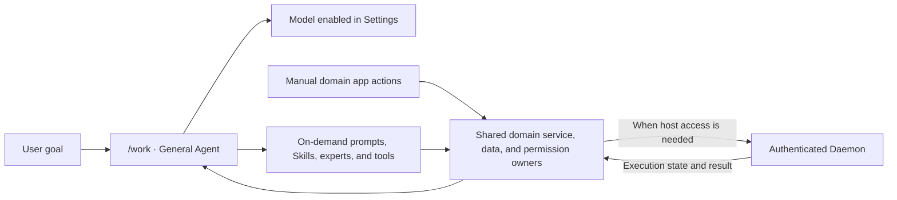

<a id="readme-top"></a>

# LFAA-Harness: AI Agent Workspace and Application Platform

[简体中文](README.md) · [Documentation index](docs/README.md) · [Development docs](docs/development/README.md)

**LFAA is a self-hosted, model-provider-agnostic AI agent workspace and application platform for work across local and remote hosts.** Users describe a goal; the configured model selects registered Skills, domain experts, and Tools as needed. Domain services and authenticated Daemons execute work and return real results. LFAA ships its own Runtime, Profile/Bundle assembly, first-party capability packages, and application services, so it does not require a separate DeepSeek Harness installation.

## Contents

- [Project overview](#project-overview)
- [Product entry and workflow](#product-workflow)
- [Capabilities and current status](#capabilities-and-status)
- [Frequently asked questions](#common-questions)
- [First use](#first-use)
- [Run Web from source](#run-web)
- [Build and package commands](#build-and-package)
- [Windows Electron desktop](#windows-desktop)
- [Build output locations](#build-outputs)
- [Data, models, and permissions](#data-model-permissions)
- [Documentation map](#documentation-map)

<a id="project-overview"></a>
## Project overview

In `/work`, a user describes a goal in natural language. The model plans from the active Profile, the system-configured Provider, and the capabilities actually available, then continues from returned tool results. First-party plugins and capability packages provide the product capabilities. A Profile selects a runtime combination, and a Bundle declares application assembly.

The product combines one general Agent workspace with domain applications. The Agent understands goals, calls capabilities, and reports results. Domain applications provide conventional operation screens and result management. Both use the same domain services, data owners, and permission owners, so chat and manual screens do not implement separate business rules.

<a id="product-workflow"></a>
## Product entry and workflow

Agent conversations use `/work` as the unified entry. The old `/tasks` and former app-specific work routes remain only for compatibility normalization; they are not current product entry points. Open domain applications from the global navigation.



The execution path is:

1. The user describes a goal in `/work` or performs a manual action in a domain app.
2. The Agent uses the system-configured Provider and active model. The model discovers, loads, and selects real capabilities according to the goal; keyword routing and fixed business flows do not replace model decisions.
3. Tool calls go to their domain owner, which validates account identity, data scope, parameters, node, and the existing permission mode.
4. Host work is sent by the Control Plane to an authenticated Daemon. The Daemon reports execution state and results, which the Agent uses to continue or finish the task.

<a id="capabilities-and-status"></a>
## Capabilities and current status

The table summarizes the product areas and capabilities integrated in source. Actual entry points depend on the active Profile, settings, account permissions, Provider connection, and node availability. See the [current development plan](docs/开发计划.md) for detailed status and unverified boundaries (Chinese).

| Area | Purpose | Status and further reading |
|---|---|---|
| General Agent workspace | Work with a model in `/work`; use registered project, file, Git, browser, and other tools as available | Browser and computer-use features depend on settings, Profile, runtime, and permissions. See [general Agent capabilities](docs/development/general-agent-capabilities-20261009.md) (Chinese) and the [Xiaoyu workspace guide](docs/development/xiaoyu-agent.md) |
| Games and runtimes | Manage Minecraft servers and runtimes such as Java; bring SteamCMD dedicated servers into the unified game library | Minecraft deployment depends on the core, version, and target node. SteamCMD game-library integration is still in progress. See [game library notes](docs/development/game-library-runtime-20261014.md) (Chinese) and the [current SteamCMD task](docs/PROMPTS.md#lfaa-game-library-workspace-steamcmd-20261023) (Chinese) |
| Writing | Manage the current account's works, reference material, and writing tasks; the Agent loads relevant content as needed | Work content remains owned by the writing domain. Skills and prompts provide methods; they do not grant extra file or write access. See the [system architecture](docs/系统总体架构.md) (Chinese) |
| AI video | Organize projects, scripts, character/scene references, storyboards, media, and timelines | Image/video generation uses configured remote Providers or available local models. See the [current plan](docs/开发计划.md) and [AI video canvas notes](docs/development/ai-video-canvas-mvp-20261010.md) (Chinese) for real-run and desktop acceptance status |
| Game connectivity | Combine network engine, node installation, and route capabilities | Player gateway, full invitations/voice/collaboration, and real cross-network acceptance are still pending; this is not a complete multiplayer service. See the [system architecture](docs/系统总体架构.md) (Chinese) |

The [Harness package inventory](docs/harness-packages.md) (Chinese) lists capability registrations and package status. A directory's presence alone does not mean it is assembled or runnable; check the active Profile and development plan.

<a id="common-questions"></a>
## Frequently asked questions

### What is LFAA?

LFAA is a self-hosted AI agent workspace and application platform. Users state a goal, the model selects assembled Skills, Tools, experts, and plugins as needed, and domain apps and services own their data, permissions, and execution rules.

### Do I need to install DeepSeek Harness separately?

No. LFAA provides its own Runtime, Profile/Bundle assembly, first-party capability packages, and application services.

### Does every LFAA login need its own model and API key?

No. An administrator manages the system-shared Providers, models, and API keys in **Settings → AI and Models**. All logged-in users read the same model catalog. The Control Plane encrypts API keys and does not return them to the browser; runtime preferences such as `aiRuntime` remain account-scoped.

### How does the Agent use tools and remote hosts?

The model chooses Tools from the capabilities actually available for the current goal. Domain services validate identity, parameters, data scope, and the permission mode. When a task needs host execution, the Control Plane sends it to an authenticated Daemon and uses the real status and result returned by that Daemon.

### Which capabilities are currently available?

See the capability table above and the [current development plan](docs/开发计划.md) (Chinese). Actual availability depends on the Profile, settings, permissions, Provider connection, and node status; a source directory alone does not mean a capability is assembled or runnable.

<a id="first-use"></a>
## First use

1. Build and start Web with the commands below, or use the `lfaa.bat` launcher on Windows.
2. Open `http://127.0.0.1:3000`. On the first visit with a new data directory, create the super-administrator account when prompted. Existing data directories keep their existing account.
3. An administrator opens **Settings → AI and Models** to configure system-shared Providers, API keys, and models, then selects the active model. All logged-in users share this model catalog. The settings service encrypts API keys and does not return them to the browser. Provider requests may incur charges under the Provider's terms.
4. Return to `/work` to start a conversation. Open a domain app from the global navigation to use its manual interface; the Agent shares its business service.
5. Whether an action waits for approval depends on the account's permission mode and the action's risk. Remote host actions also require a connected node with the needed capability.

See the detailed [CLI configuration and data guide](docs/user/cli.zh.md#配置与数据) (Chinese) and [execution control contract](docs/subsystems/execution-control.md) for deployment, identity, authorization, and node boundaries.

<a id="run-web"></a>
## Run Web from source

### Requirements

- Node.js `>=24.15.0`
- pnpm `11.17.0`, as declared in the root `package.json`
- Rust stable with the MSVC target for Windows desktop packaging; ordinary Web builds do not require Rust

### Clone, install, build, and start

```sh
git clone https://github.com/yubboo/LFAA.git lfaa
cd lfaa
pnpm install
pnpm run build
pnpm lfaa web
```

`pnpm run build` creates the Harness, Web, Control Plane, and CLI runtime trees. `pnpm lfaa web` starts the built Web service, normally serving the UI, API, and Socket.IO from `http://127.0.0.1:3000`. Deployment settings can change the listen address. Press `Ctrl+C` to stop the service cleanly.

Windows x64 local mode hosts a local Daemon. Add `--no-local-daemon` to run only the Web Control Plane. See the [detailed CLI guide](docs/user/cli.zh.md) (Chinese) for standalone Daemon commands, Windows menu steps, ports, and data directories.

### Development mode

```sh
pnpm dev
```

The development launcher starts the frontend, Control Plane, and local Daemon. `pnpm run dev:frontend` starts only Vite and requires an existing Control Plane. Other service-specific commands are in the [CLI guide](docs/user/cli.md).

<a id="build-and-package"></a>
## Build and package commands

Run these commands from the repository root. Web is a same-origin UI/API/Socket.IO service; building frontend assets alone does not build the complete Web service.

To build a runnable Web service, run `pnpm run build` and then `pnpm lfaa web`. `pnpm run build:web` only builds frontend assets; it does not package the API and Socket.IO service by itself.

| Goal | Command | Result |
|---|---|---|
| Build only the Web frontend | `pnpm run build:web` | Writes to `dist/apps/web/`; does not include the Control Plane |
| Build only the Control Plane | `pnpm run build:control-plane` | Writes to `dist/apps/control-plane/` |
| Build the complete source runtime | `pnpm run build` | Builds Harness packages, Web, Control Plane, and CLI; start it with `pnpm lfaa web` |
| Create a local npm CLI tarball | `pnpm run pack:cli` | Builds first, then writes a `.tgz` to `dist/npm/`; does not publish to npm |
| Build a Windows Electron installer | `pnpm run build:desktop:win` | Builds Control Plane, Windows Sandbox Host, and an isolated Web candidate, then creates an x64 NSIS installer |
| Build the Windows Tauri compatibility shell | `pnpm run build:desktop:tauri:win` | Compatibility entry only; not the current desktop mainline |

`pnpm run build:desktop:win` is the recommended Windows desktop command. The explicit equivalent is `pnpm run build:desktop:electron:win`. Desktop builds validate the Electron version, update manifest, and [product changelog](docs/updata-log.md); update the release metadata before building a new product version. See [Electron desktop notes](apps/desktop-electron/README.md) for packaging details.

<a id="windows-desktop"></a>
## Windows Electron desktop

The current desktop line is Windows x64 Electron. Install workspace dependencies and prepare Rust stable with the MSVC target, then run at the repository root:

```powershell
pnpm run build:desktop:win
```

The command builds the Control Plane, native Windows Sandbox Host, and Web candidate, then uses Electron Builder to create an NSIS installer. It verifies the installer, update manifest, file size, and hash. The build does not upload or publish files. Final files are placed here:

```text
dist/apps/desktop-electron/LFAA-<version>/
├── LFAA-<version>.exe
├── LFAA-<version>.exe.blockmap
└── latest.yml
```

Install the `.exe` on Windows to use the desktop app. The package includes the shared Client, Control Plane, and local Daemon; remote nodes still need their own connection configuration. Only the Windows x64 NSIS route is currently registered. macOS Electron packaging/signing, Linux desktop, and Android are not delivered, so there is no available macOS/Linux desktop packaging command.

Windows users can also double-click `lfaa.bat`: menu `1` installs dependencies, menu `2` then `1` starts Web, and menu `3` builds the Windows Electron installer. See the [CLI guide](docs/user/cli.md) (English entry; detailed menu steps are in Chinese).

<a id="build-outputs"></a>
## Build output locations

All product build and packaging output goes under the repository root `dist/`:

| Output | Location |
|---|---|
| Harness capability packages | `dist/packages/<domain>/<package>/` |
| Web frontend | `dist/apps/web/` |
| Control Plane | `dist/apps/control-plane/` |
| Daemon runtime entry | `dist/apps/daemon/` |
| npm package directory and tarball | `dist/npm/lfaa/`, `dist/npm/*.tgz` |
| Final Electron installer files | `dist/apps/desktop-electron/LFAA-<version>/` |
| Temporary desktop assembly | `dist/.tmp/desktop-electron/` |

The regular `pnpm run build` does not create a desktop installer or increment the product version. See the [CLI build and artifact guide](docs/user/cli.md) for more details.

<a id="data-model-permissions"></a>
## Data, models, and permissions

- **System models:** An administrator configures Providers, models, and API keys shared by all logged-in users. The backend Settings/Credentials owners encrypt API keys; account-scoped runtime and image/video model preferences remain separate. Do not put secrets in the frontend or README examples. Real requests may incur Provider charges.
- **User data:** Accounts, sessions, settings, projects, and app data are persisted by their respective owners. Runtime locations are controlled by deployment settings such as `LFAA_DATA_DIR`; changing the directory does not automatically move existing data. Read the [storage guide](docs/subsystems/storage.md) and [CLI data guide](docs/user/cli.md).
- **Permission execution:** Request approval, approve for me, and full access are shared permission modes in Settings. Tools still pass server-side identity, parameter, target, and data-scope validation. Full access is not an operating-system sandbox.
- **Public deployment:** Public listeners require a strong `JWT_SECRET` and an absolute persistent data directory. Review the [CLI configuration guide](docs/user/cli.md) before exposing a local setup to the network.

<a id="documentation-map"></a>
## Documentation map

### For users and operators

| Topic | Document |
|---|---|
| Install dependencies; start Web/Daemon; Windows menus | [CLI entry guide](docs/user/cli.md) (English entry) · [detailed CLI guide](docs/user/cli.zh.md) (Chinese) |
| Ports, data directories, environment variables, local/public mode | [CLI configuration and data](docs/user/cli.zh.md#配置与数据) (Chinese) |
| Electron packaging and delivered files | [Electron desktop notes](apps/desktop-electron/README.md) (Chinese) |
| Product release versions and changes | [Changelog](docs/updata-log.md) (Chinese) |

### Architecture and capabilities

| Topic | Document |
|---|---|
| Product identity, entry points, AI, apps, and node architecture | [System architecture](docs/系统总体架构.md) (Chinese) |
| Integrated capabilities, remaining work, and unverified boundaries | [Current development plan](docs/开发计划.md) (Chinese) |
| General Agent, capability discovery, and execution boundaries | [General Agent capability record](docs/development/general-agent-capabilities-20261009.md) |
| Game library and runtime implementation | [Game library notes](docs/development/game-library-runtime-20261014.md) (Chinese) |
| Session, settings, and file data ownership | [Storage guide](docs/subsystems/storage.md) |
| Account permissions, node actions, and safe execution | [Execution control](docs/subsystems/execution-control.md) |

### Development and maintenance

| Topic | Document |
|---|---|
| All documentation entry points | [Documentation index](docs/README.md) |
| Long-term engineering guides and implementation records | [Development documentation index](docs/development/README.md) |
| Package owners, public contracts, and app assembly | [Package responsibilities](docs/development/package-responsibilities.md) |
| Feature map and task/acceptance process | [Developer handbook](docs/development/handbook.md) · [Task contract index](docs/PROMPTS.md) (Chinese) |
| Capability packages and placeholders | [Harness package inventory](docs/harness-packages.md) (Chinese) |
| Repository change and delivery rules | [Development conventions](开发规范.md) (Chinese) |
| Archived audits, plans, and completed contracts | [Archive index](docs/archive/README.md) |

[Back to top](#readme-top)
