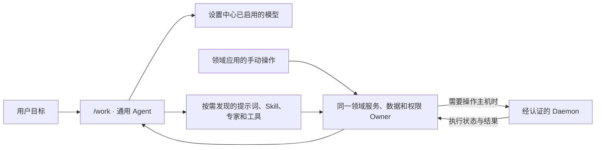

<a id="readme-top"></a>

# LFAA-Harness：AI Agent 工作台与应用平台

[English](README.en.md) · [文档总目录](docs/README.zh.md) · [开发文档索引](docs/development/README.zh.md)

**LFAA（小鱼智能体）是一款可自托管、与模型服务商解耦的 AI Agent 工作台与应用平台，面向本机和远程主机上的实际工作。** 用户描述目标后，当前已配置模型会按需选择已登记的 Skills、领域专家和 Tools；领域服务与经过认证的 Daemon 执行工作并返回真实结果。LFAA 自带 Runtime、Profile/Bundle、第一方能力包和应用服务，不需要另外安装 DeepSeek Harness。

## 目录

- [项目定位](#project-overview)
- [产品入口与工作方式](#product-workflow)
- [主要能力与当前边界](#capabilities-and-status)
- [常见问题](#common-questions)
- [首次使用](#first-use)
- [从源码运行 Web](#run-web)
- [构建与打包命令](#build-and-package)
- [Windows Electron 桌面端](#windows-desktop)
- [构建产物位置](#build-outputs)
- [数据、模型与权限](#data-model-permissions)
- [文档导航](#documentation-map)

<a id="project-overview"></a>
## 项目定位

在 `/work` 中，用户以自然语言描述目标；模型结合当前 Profile、系统级 Provider 配置和实际可用的能力规划工作，并依据工具返回的结果继续判断。具体能力由 LFAA 第一方插件和能力包装配；Profile 选择运行组合，Bundle 声明应用装配。

产品由统一的 Agent 工作区和多个领域应用组成：Agent 负责理解目标、调用能力和汇报结果；领域应用提供传统操作界面和成果管理。二者共用对应的领域服务、数据和权限 Owner，避免聊天入口与手动页面各自实现一套业务规则。

<a id="product-workflow"></a>
## 产品入口与工作方式

智能体对话的统一入口是 `/work`。旧 `/tasks` 和过去的 App 专属工作路由只用于兼容归一，不是当前产品主入口。专业应用从全局导航进入。



工作流程如下：

1. 用户在 `/work` 描述目标，或者在领域应用中执行手动操作。
2. Agent 使用系统配置的 Provider 和活动模型；模型按目标发现、加载并选择真实可用的能力，不由关键词或固定业务流程替代模型判断。
3. 工具调用进入其所属的业务 Owner，由 Owner 校验账户、数据范围、参数、节点和现有权限模式。
4. 需要在主机上执行的工作经控制端派发给已认证的 Daemon；Daemon 返回执行状态和结果，Agent 再据此继续或结束任务。

<a id="capabilities-and-status"></a>
## 主要能力与当前边界

下表概述产品方向和源码中已接入的能力。实际入口会受 Profile、设置、账户权限、Provider 连接和节点在线状态影响；具体完成情况以[当前开发计划](docs/开发计划.md)为准。

| 模块 | 用途 | 当前边界与进一步阅读 |
|---|---|---|
| 通用 Agent 工作区 | 在 `/work` 与模型协作；按需使用项目、文件、Git、浏览器和其他已登记工具 | 浏览器和电脑操控能力受对应设置、Profile、运行环境和权限约束；见[Agent 能力说明](docs/development/general-agent-capabilities-20261009.md)、[小鱼工作区说明](docs/development/xiaoyu-agent.zh.md) |
| 游戏与运行环境 | 管理 Minecraft 服务端及 Java 等运行环境；逐步把 SteamCMD 专用服务端纳入统一游戏库 | Minecraft 的部署与执行取决于核心、版本和目标节点；SteamCMD 游戏库整合仍在实施中。见[游戏库记录](docs/development/game-library-runtime-20261014.md)及[当前 SteamCMD 合同](docs/PROMPTS.md#lfaa-game-library-workspace-steamcmd-20261023) |
| 写作 | 管理账户自己的作品、资料和写作流程，Agent 按需读取相关内容 | 作品内容仍由写作 Owner 管理；Skill 和提示词提供方法，不自动扩大文件访问或写入权限。见[系统架构](docs/系统总体架构.md) |
| AI 漫剧 | 围绕项目、剧本、角色/场景参考图、分镜、媒体和时间线组织制作 | 图像/视频生成使用已配置的远程 Provider 或可用的本机模型；实际推理、设备和桌面验收状态见[开发计划](docs/开发计划.md)及[漫剧画布记录](docs/development/ai-video-canvas-mvp-20261010.md) |
| 跨游戏联机 | 整合组网引擎、节点安装和路由相关能力 | 当前仍缺玩家网关、完整邀请/语音/协作及真实跨网验收，不能视作完整联机服务。见[系统架构](docs/系统总体架构.md) |

能力登记、目录和包状态可在[Harness 包清单](docs/harness-packages.md)查看。目录中存在的包不一定已装配或可运行；请结合当前 Profile 和开发计划判断。

<a id="common-questions"></a>
## 常见问题

### LFAA 是什么？

LFAA 是可自托管的 AI Agent 工作台与应用平台：用户提出目标，模型按需使用已装配的 Skills、Tools、专家与插件，领域应用和服务负责各自的数据、权限与执行规则。

### 使用 LFAA 需要另外安装 DeepSeek Harness 吗？

不需要。LFAA 提供自己的 Runtime、Profile/Bundle、第一方能力包和应用服务；DeepSeek Harness 不需要单独安装。

### 每个登录用户都要配置一套模型和 API Key 吗？

不需要。管理员在设置中心「AI 与模型」维护系统共享的 Provider、模型和 API Key，所有登录用户读取同一模型集合。API Key 由控制端加密保存，不会返回浏览器；`aiRuntime` 等运行偏好仍由各自账户保存。

### Agent 如何使用工具并操作远程主机？

模型根据当前目标和真实可用目录选择 Tools；领域服务继续校验账户、参数、数据范围和权限模式。需要主机执行时，控制端把任务交给经过认证的 Daemon，并使用其返回的真实状态与结果。

### 哪些能力已经可用？

请查看上方能力表和[当前开发计划](docs/开发计划.md)。实际入口取决于 Profile、设置、权限、Provider 连接和节点状态；源码目录存在本身不代表该能力已经装配或可运行。

<a id="first-use"></a>
## 首次使用

1. 按下方命令构建并启动 Web，或在 Windows 使用根目录的 `lfaa.bat` 工作台。
2. 在浏览器打开 `http://127.0.0.1:3000`。新数据目录首次访问时按页面提示创建超级管理员账户；已有数据目录直接使用原账户登录。
3. 管理员登录后进入“设置中心 → AI 与模型”，配置系统共享 Provider、API Key 和模型，并选择活动模型。所有登录用户共用这组模型；密钥由设置服务加密保存，不会返回浏览器。Provider 请求可能按服务商规则计费。
4. 回到 `/work` 开始对话。需要使用游戏、写作或漫剧功能时，从全局导航打开对应应用；Agent 与手动操作共用其业务服务。
5. 工具执行是否等待逐项审批，由设置中心的账户权限模式和具体操作风险决定。远程主机功能还要求节点已连接且具备对应能力。

Provider、数据目录和部署环境的详细配置见[CLI 配置与数据说明](docs/user/cli.zh.md#配置与数据)；认证、授权和节点执行合同见[执行控制说明](docs/subsystems/execution-control.zh.md)。

<a id="run-web"></a>
## 从源码运行 Web

### 环境要求

- Node.js `>=24.15.0`
- pnpm `11.17.0`（版本由根目录 `package.json` 声明）
- Windows 桌面安装包另需 Rust stable MSVC 工具链；普通 Web 构建不需要 Rust。

### 克隆、安装、构建并启动

```sh
git clone https://github.com/yubboo/LFAA.git lfaa
cd lfaa
pnpm install
pnpm run build
pnpm lfaa web
```

`pnpm run build` 生成完整的 Harness、Web、Control Plane 和 CLI 运行树。`pnpm lfaa web` 使用构建产物启动 Web 服务；默认由 `http://127.0.0.1:3000` 同源提供页面、API 和 Socket.IO，实际监听地址可由部署配置调整。按 `Ctrl+C` 正常停止服务。

Windows x64 本机模式会托管本机 Daemon；如只需要 Web 控制端，可加 `--no-local-daemon`。独立 Daemon 启动方式、Windows 菜单步骤及端口/数据目录配置见[CLI 启动指南](docs/user/cli.zh.md)。

### 开发模式

```sh
pnpm dev
```

开发启动器负责启动前端、Control Plane 和本机 Daemon。只启动 Vite 前端的命令是 `pnpm run dev:frontend`，它需要现有 Control Plane；分别启动其他服务的命令见[CLI 指南](docs/user/cli.zh.md#windows-工作台)。

<a id="build-and-package"></a>
## 构建与打包命令

以下命令均从仓库根目录运行。Web 是同源 UI/API/Socket.IO 服务，构建前端静态资源不等于构建完整 Web 服务。

如果要得到可启动的完整 Web 服务，运行 `pnpm run build` 后再执行 `pnpm lfaa web`。`pnpm run build:web` 只构建前端资源；它不会单独打包 API 和 Socket.IO 服务。

| 目标 | 命令 | 结果 |
|---|---|---|
| 只构建 Web 前端 | `pnpm run build:web` | 写入 `dist/apps/web/`；不单独包含 Control Plane |
| 只构建 Control Plane | `pnpm run build:control-plane` | 写入 `dist/apps/control-plane/` |
| 构建完整源码运行树 | `pnpm run build` | 构建 Harness 包、Web、Control Plane 和 CLI；之后用 `pnpm lfaa web` 启动 |
| 本地组装 npm CLI tarball | `pnpm run pack:cli` | 完整构建后把 `.tgz` 写入 `dist/npm/`；只生成本地产物，不会发布到 npm |
| 构建 Windows Electron 安装包 | `pnpm run build:desktop:win` | 自动构建 Control Plane、Windows Sandbox Host 和隔离 Web 候选，再生成 x64 NSIS 安装包 |
| Windows Tauri 兼容构建 | `pnpm run build:desktop:tauri:win` | 保留的兼容入口，不是当前桌面主线 |

`pnpm run build:desktop:win` 是推荐的 Windows 桌面命令，也可显式运行 `pnpm run build:desktop:electron:win`。桌面构建会校验 Electron 版本、更新清单与[产品更新日志](docs/updata-log.md)；新版本构建前先按更新流程更新这些元数据。桌面流程与安装包内容见[Electron 桌面说明](apps/desktop-electron/README.md)。

<a id="windows-desktop"></a>
## Windows Electron 桌面端

桌面主线是 Windows x64 Electron。完成仓库依赖安装并准备 Rust stable MSVC 工具链后，从仓库根目录运行：

```powershell
pnpm run build:desktop:win
```

该命令会构建 Control Plane、Windows 原生 Sandbox Host 和 Web 候选，随后使用 Electron Builder 生成 NSIS 安装程序，并核对安装器、更新清单、文件大小和哈希。构建过程不会上传或发布文件。最终文件位于：

```text
dist/apps/desktop-electron/LFAA-<版本号>/
├── LFAA-<版本号>.exe
├── LFAA-<版本号>.exe.blockmap
└── latest.yml
```

将 `.exe` 安装到 Windows 后即可启动桌面版。桌面包内含共享客户端、Control Plane 和本机 Daemon；远程节点仍需单独配置连接。当前只有 Windows x64 NSIS 路线已登记；macOS Electron 打包和签名、Linux 桌面及 Android 尚未交付，因此没有可用的 macOS/Linux 桌面打包命令。

日常 Windows 用户也可双击 `lfaa.bat`：菜单 `1` 安装依赖，菜单 `2` 后选择 `1` 启动 Web，菜单 `3` 构建 Windows Electron 安装包。详细菜单行为见[Windows 工作台指南](docs/user/cli.zh.md#windows-工作台)。

<a id="build-outputs"></a>
## 构建产物位置

所有产品构建和打包产物都写入仓库根目录 `dist/`：

| 内容 | 位置 |
|---|---|
| Harness 能力包 | `dist/packages/<领域>/<包名>/` |
| Web 前端 | `dist/apps/web/` |
| Control Plane | `dist/apps/control-plane/` |
| Daemon 运行入口 | `dist/apps/daemon/` |
| npm 发布目录与 tarball | `dist/npm/lfaa/`、`dist/npm/*.tgz` |
| Electron 最终安装文件 | `dist/apps/desktop-electron/LFAA-<版本号>/` |
| 桌面临时组装目录 | `dist/.tmp/desktop-electron/` |

普通 `pnpm run build` 不生成桌面安装包，也不递增产品版本。更多入口、数据与构建边界见[CLI 指南](docs/user/cli.zh.md#命令与产物)。

<a id="data-model-permissions"></a>
## 数据、模型与权限

- **系统模型：** 管理员在设置中心配置所有登录用户共享的 Provider、模型和 API Key；密钥由后端设置/凭据 Owner 加密保存，不放进前端或 README 示例中。账户级运行参数及图像/视频模型偏好仍按账户保存；真实请求可能产生 Provider 费用。
- **用户数据：** 账户、会话、设置、项目和应用数据由各自 Owner 持久化，运行目录由 `LFAA_DATA_DIR` 等部署配置决定。换目录不会自动搬迁旧数据；迁移前应查看[存储说明](docs/subsystems/storage.zh.md)和[CLI 配置说明](docs/user/cli.zh.md#配置与数据)。
- **权限执行：** 请求审批、替我审批、完全访问是设置中心统一提供的权限模式。工具仍须经过服务端身份、参数、目标和数据范围校验；完全访问不等于操作系统沙盒。
- **公开部署：** 公网监听需要强 `JWT_SECRET` 和绝对持久化数据目录，不能把本机回环开发配置直接暴露到公网。请先阅读[CLI 配置与数据说明](docs/user/cli.zh.md#配置与数据)。

<a id="documentation-map"></a>
## 文档导航

### 用户与运行

| 想了解 | 文档 |
|---|---|
| 安装依赖、启动 Web/Daemon、Windows 菜单 | [CLI 启动与打包指南](docs/user/cli.zh.md) |
| 端口、数据目录、环境变量和本地/公网模式 | [CLI 配置与数据](docs/user/cli.zh.md#配置与数据) |
| Electron 安装包构建流程和交付文件 | [Electron 桌面说明](apps/desktop-electron/README.md) |
| 产品发行版本和更新记录 | [更新日志](docs/updata-log.md) |

### 架构与能力

| 想了解 | 文档 |
|---|---|
| 当前产品身份、工作入口、AI、应用与节点架构 | [系统总体架构](docs/系统总体架构.md) |
| 已接入能力、待办与未验收边界 | [当前开发计划](docs/开发计划.md) |
| 通用 Agent、工具发现与执行边界 | [Agent 通用能力记录](docs/development/general-agent-capabilities-20261009.md) |
| 游戏库与运行环境实现记录 | [游戏库记录](docs/development/game-library-runtime-20261014.md) |
| 会话、设置和文件的存储归属 | [存储说明](docs/subsystems/storage.zh.md) |
| 账户权限、节点操作和安全执行边界 | [执行控制说明](docs/subsystems/execution-control.zh.md) |

### 开发与维护

| 想了解 | 文档 |
|---|---|
| 所有文档入口 | [文档总目录](docs/README.zh.md) |
| 长期工程指南与专题实施记录 | [开发文档索引](docs/development/README.zh.md) |
| 包 Owner、公开合同和应用装配 | [包职责与应用装配规范](docs/development/package-responsibilities.zh.md) |
| 功能地图、任务登记与验收方法 | [开发手册](docs/development/handbook.zh.md) · [任务合同索引](docs/PROMPTS.md) |
| 能力包与占位目录状态 | [Harness 包清单](docs/harness-packages.md) |
| 仓库修改与交付规则 | [开发规范](开发规范.md) |
| 已归档的审计、计划和历史合同 | [归档索引](docs/archive/README.zh.md) |

[返回顶部](#readme-top)
