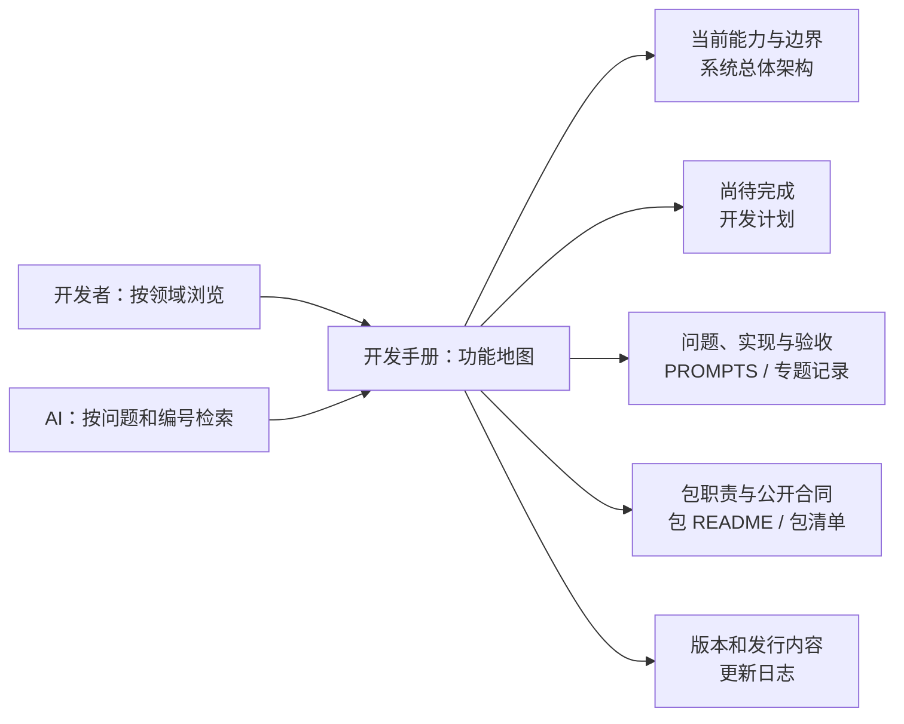

# LFAA 开发手册：功能地图与开发记录

[English entry](handbook.md) · [文档目录](../README.zh.md)

这本手册给 LFAA 开发者和 AI 共用。它把“用户遇到什么问题、项目怎么解决、代码由谁负责、证据在哪里”串成一条可浏览的路径。手册是导航页；架构、计划、任务合同、包职责与版本仍各有唯一权威来源。

运行项目后也可以打开 **设置中心 → 关于与更新 → LFAA 开发手册**。应用内页面按左一全局导航、左二工作区导航、中间工作区、右侧 Dock、设置中心及业务工作区逐个说明解决的问题、组件 Owner、实现方式、设置/数据归属、响应式行为和相关任务证据。页面内容由 [`developer-handbook-content.ts`](../../packages/client/ui-settings/src/developer-handbook-content.ts) 结构化维护；手册界面由 `ui-settings` 包呈现。AI 可直接检索该结构化源码；人可以在项目里通过可点击区域图和目录浏览。

## 先从这里找

| 想了解 | 先看 | 再看 |
|---|---|---|
| 现在产品实际有什么、哪些还没做 | [系统总体架构](../系统总体架构.md) | [开发计划](../开发计划.md) |
| 某项功能解决了什么、采用了什么实现、怎么验收 | [任务合同与记录索引](../PROMPTS.md) | 下方的领域专题与具体合同 |
| 一个包的 Owner、入口、消费者和边界 | [包职责与应用装配规范](package-responsibilities.zh.md) | [生成包清单](../harness-packages.md) 和该包 `README.md` |
| 怎么开始修改与交付 | [开发流程](guide.zh.md) | [开发规范](../../开发规范.md) |
| 当前产品版本和发行说明 | [更新日志](../updata-log.md) | [CLI 与启动指南](../user/cli.zh.md) |

## 文档如何拼成一张图

同一份 Markdown 既可以按目录供人浏览，也可以让 AI 按链接、标题和任务编号继续读取。图中的箭头表示阅读路线，不表示任何运行时调用链。



### 事实来源顺序

| 要确认的事实 | 权威来源 | 阅读时要留意 |
|---|---|---|
| 当前架构、真实能力、限制 | [系统总体架构](../系统总体架构.md) 与当前源码 | 历史合同不能覆盖当前源码事实。目录存在也不代表能力已装配或可用。 |
| 后续目标与缺口 | [开发计划](../开发计划.md) | 计划中的目标不代表已实现。 |
| 某次为什么改、具体怎么改、实际验了什么 | [PROMPTS](../PROMPTS.md) 中对应任务合同和链接的实施记录 | 历史验收只证明当轮、当环境、当范围；未验边界要一起读。 |
| 包的真实职责、依赖和公开入口 | 包内 `README.md`、[包职责规范](package-responsibilities.zh.md)、[生成包清单](../harness-packages.md) | 清单中的源码/装配/实测状态必须分别理解。 |
| 正式版本与发布说明 | [更新日志](../updata-log.md) | 开发合同不是产品版本日志。 |

## 功能地图

这些专题是快速入口和代表性案例，不是另造一份当前能力总账。开始开发前，回到架构、计划、最新合同和当前代码核实状态；未实现、实施中和未实测项目要按原记录如实呈现。

| 领域 | 解决的问题 | 实现方式与 Owner 导航 | 详细记录 / 当前边界 |
|---|---|---|---|
| Harness、包与装配 | 让 LFAA 有自己的启动、能力登记、Profile/Bundle 组合和生命周期 | 从 [系统架构](../系统总体架构.md) 进入，再按 [包职责规范](package-responsibilities.zh.md) 找包 Owner | [包清单](../harness-packages.md) 区分源码、装配与验收状态；规范目标不等于全仓已完成迁移。 |
| AI Work、模型与工具 | 让模型根据用户目标理解任务、按需选取真实工具并依据真实结果继续工作 | [Agent 通用能力](general-agent-capabilities-20261009.md)、[小鱼智能体入口](xiaoyu-agent-20261015.md)；核心循环、工具、服务和执行节点由不同 Owner 配合 | 先看[架构中的 Agent 边界](../系统总体架构.md)，再看合同里的 Provider、工具和 Daemon 未验范围。 |
| 工作台、应用导航与会话 | 让专业应用和 AI Work 共享一致的工作区入口、导航与账户会话 | [应用面板与模板目标](application-panels-20261016.md)、[架构现状](../系统总体架构.md) | 2026-10-20 的应用导航右移仍以[合同 144](../PROMPTS.md#lfaa-workspace-application-navigation-right-dock-20261020)的实施状态为准；未完成前不按目标描述宣称已验收。 |
| 设置、权限与外观 | 让配置由设置中心持有，操作服从统一权限 Owner，界面读取现有外观偏好 | [开发规范](../../开发规范.md)、[设置包职责](../../packages/settings/settings/README.md)、[设置 UI](../../packages/client/ui-settings/README.md) | [性能、安全与可维护性记录](performance.zh.md)说明共享链路约束；设置保存或浏览器观感只在相应合同确实验证后标为通过。 |
| 文件、项目与数据 | 让文件能力有清晰的账户/项目/节点归属，并保护路径、并发写入和运行数据 | [文件管理参考](file-manager-reference-20261013.md)、[文件资源导航](file-resources.zh.md) | 当前 API、Daemon、文件域迁移状态见[架构事实](../系统总体架构.md)与 [PROMPTS 中的文件服务合同](../PROMPTS.md#lfaa-system-file-service-20261013)。 |
| 插件、MCP、Skills 与提示词 | 让真实扩展能力使用原有来源、配置、安装、发现、执行和卸载责任边界 | [插件生命周期与会话响应式记录](plugin-lifecycle-session-responsive-20261016.md)、[扩展审计](dsh-lfaa-extension-audit-20261017.md) | Profile 中实际装配与用户配置的 MCP/Skill 以各自 Owner 和账户数据为准；没有真实目录或执行器的能力不能按名称推断可用。 |
| Writing 写作工作区 | 让作品内容、元数据、提案和审阅使用账户隔离的真实存储与同一业务服务 | [Writing 本地文件记录](writing-local-files-20261010.md)、[写作包合同](../../packages/document/writing/README.md) | 具体存储、迁移和模型提案行为以架构、Writing Owner 与对应任务合同为准。 |
| AI 漫剧与媒体 | 记录分镜、项目文件、图像/视频生成、预览与导出的逐步接入边界 | [画布 MVP](ai-video-canvas-mvp-20261010.md)、[图像生成记录](ai-video-image-generation-20261011.md) | 合成/静态验证不代表真实 Provider、手机相机、设备权限、桌面或音画体验已经实测。 |
| 游戏、运行环境与 Daemon | 让游戏库、安装/运行环境、实例领域规则和节点执行分属对应 Owner | [游戏库与运行环境](game-library-runtime-20261014.md)、[运行环境修复](runtime-manual-repair-20261014.md) | 真实节点、运行中实例、下载来源和平台限制按最新合同核验；控制端记录不代替 Daemon 实机结果。 |
| 性能、安全与质量 | 让读取有界、请求可撤销、写入可核验、性能证据对应真实工作量和宿主 | [性能治理](performance.zh.md)、[开发流程](guide.zh.md) | 类型/构建、回归、浏览器、桌面、Provider、Daemon 与设备验收是不同证据，不互相替代。 |

## 给 AI 的阅读顺序

收到 LFAA 开发问题时，按这个顺序建立当前结论，避免把旧实现记录误当成当前代码：

1. 从上方功能地图选领域；先读[系统总体架构](../系统总体架构.md)和[开发计划](../开发计划.md)中直接相关的部分。
2. 在 [PROMPTS 任务索引](../PROMPTS.md)搜索功能名、问题关键词或合同编号，打开最新相关合同和它链接的专题记录。
3. 沿合同的入口、调用链和 Owner 找当前包 `README.md`、公开入口、消费者及数据/权限所有者；包名只作导航线索。
4. 对照当前工作树确认代码是否仍与历史合同一致。发现冲突时，以当前代码和当前架构为准，记录差异。
5. 汇报时分别写明用户问题、实际实现、直接 Owner、验证方式/结果和未验边界。只把已真实执行的检查写成通过。

## 人类阅读路径

- **想快速了解一个领域：** 从功能地图点入架构导读和代表性专题，最后回到包 README 看当前职责。
- **想复盘一次修复：** 从 [PROMPTS 索引](../PROMPTS.md)按编号定位合同，按“目标/Owner → 允许范围 → 验收 → 实施与验收结果”阅读。
- **想知道现在还缺什么：** 对照[系统总体架构](../系统总体架构.md)和[开发计划](../开发计划.md)，不要只看旧任务是否曾经写过“完成”。
- **想看产品交付了什么：** 查[更新日志](../updata-log.md)；运行验证范围仍以对应合同记录为准。

## 怎么开发与验收：提示词和记录模板

### 以后每项功能都留下可复盘记录

每项新功能、缺陷修复和架构调整，在开始改代码前先于 [PROMPTS 任务索引](../PROMPTS.md)登记编号与合同；实现期间补充决策，完成后在同一合同记录真实改动和验收。小改动用精简合同，普通问答不用建合同。只有包职责、当前运行事实、配置合同或长期目标变化时，才同步对应 README、架构、设置或计划文档，避免重复维护同一事实。

一次完整记录按这个顺序形成：

1. **先说清用户问题：** 发生在哪个页面/操作，当前实际表现是什么，影响谁或哪条流程。
2. **确定目标和边界：** 改完用户能做什么；哪些已有行为、设置、数据和权限必须保持。
3. **从源码定位 Owner：** 找到真实入口、调用链、公开合同、数据/权限 Owner 和消费者；能从代码查明的细节由 AI 自行核实。
4. **先登记合同再实现：** 写入修改范围和可以观察的验收条件；界面工作按可单独验收的批次推进。
5. **完成后写证据：** 逐文件写职责和解决问题的方式；记录实际运行的回归/类型/构建命令、真实路由与视口、交互和截图位置；列明失败项与未测范围。

### 可以直接发给 AI 的提示词

把方括号替换成自己的描述即可。不了解包名、设置字段或 Owner 时可以留空，让 AI 从当前代码和文档确认。

```text
请在当前 LFAA 项目中完成这项修改，并遵循仓库 AGENTS.md、开发规范.md、docs/系统总体架构.md 和相关包 README。

我遇到的问题/想实现的目标：[用自己的话描述]
现在我是这样操作的：[页面、入口、操作步骤；不知道可留空]
现在实际发生：[错误、缺少的能力或目前行为]
希望改完后：[用户能做什么、界面/结果应是什么]
适用范围：[页面、账户/项目/节点、桌面/手机等；不知道可留空]
必须保留：[已有行为、设置、数据或权限边界；没有可写“请先核实”]
我认为的验收方式：[具体操作和预期结果；需要的视口可写宽×高]

请先检查当前工作树、相关任务合同和源码，沿调用链确认唯一 Owner，并盘点有关设置、默认值、持久化、数据与权限归属；不要让我重复提供代码里能查到的信息。开始实现前在 docs/PROMPTS.md 登记任务合同、允许/禁止范围和验收条件。若存在会改变数据归属、安全或用户行为的关键歧义，再简短询问；其余部分继续推进。只做必要修改。

完成后，在同一任务合同记录：每个改动文件的职责、具体解决了什么问题、实际执行的验证命令及结果、真实页面/视口/交互和截图证据、失败项及未测边界。稳定架构或包职责变化时同步对应权威文档。不要把未运行的检查写成通过，也不要提交或发布。
```

也可以用更短的自然语言开头，例如：“设置中心的插件页在窄栏时搜索框挤到下一行，帮我让分类和搜索能在 390px 容器内清晰使用；保留现有插件开关与搜索行为，完成后按项目要求记录并实页验收。” AI 会据此定位细节，不要求用户先写技术方案。

### 任务合同与完成记录模板

合同中的目标、边界和验收应在编码前填写；“实施与验收记录”在工作完成后填写。小任务可删减不适用字段，但要明确写“未涉及”，不能留空造成误解。

```markdown
## [编号]-[任务名]-[日期]

### 用户问题、目标与入口
- 用户问题及影响：
- 当前行为/复现步骤：
- 期望的用户可见结果：
- 运行入口、页面/路由和使用范围：

### Owner、设置与数据边界
- 真实调用链和唯一 Owner：
- 相关设置、默认值、读取/持久化：
- 账户/项目/节点数据、权限与认证边界：

### 修改范围与验收
- 允许修改：
- 禁止改变：
- 可观察验收条件（含适用宽高、角色和失败场景）：

### 实施与验收记录
- 具体方案：为什么这样改、如何解决原问题：
- 变更文件：仓库相对路径 — 每个文件的职责和改动：
- 实际验证：命令/回归/构建 — 结果；未运行项注明原因：
- 实际页面验收：路由、宿主、视口宽×高、交互结果、截图位置；非界面任务写“未涉及”：
- 性能/安全/可维护性证据与未测边界：
- 同步的权威文档及链接：
```

新领域或长期 UI 结构进入主功能地图时，补充本手册导航；普通任务历史留在 PROMPTS 合同，不要求每做一次小修复就复制一遍到手册。

## 维护边界

- 手册维护链接、阅读路径和代表性功能地图；当前能力只由架构与代码确认，开发缺口只由计划维护，产品版本只由更新日志维护。
- 任务合同是一次开发的决策与验收记录。需要被持续理解的包职责同步到对应包 README；运行事实改变时同步架构，不能只更新历史合同。
- 文档链接应指向仓库相对路径。历史绝对路径仅描述当时环境，不是当前 checkout 的定位依据。
- 不把“目录存在、源码可编译、构建成功”当作装配、执行或用户体验的证据。
