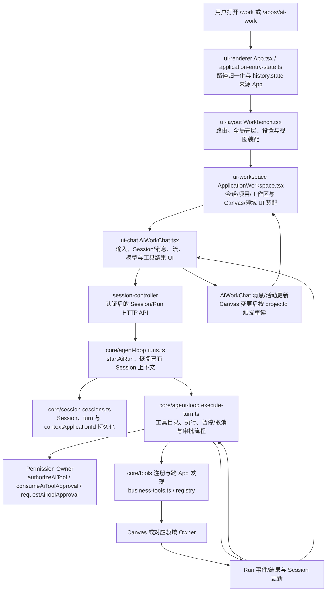
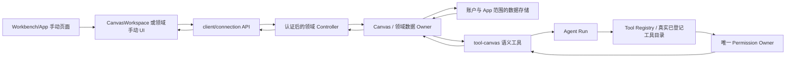

# P0 实际调用链与 Owner 图

本图按 `E:\lfaa1\lfaa` 当前 checkout 的源码和已有未提交差异整理。它描述当前实现，不预设计划中的 Task/ResourceRef/Capability 设计已经落地。

## `/work`、Session 与 Agent Run

### 入口与会话事实

- `packages/client/ui-renderer/src/application-entry-state.ts` 将 `/apps/<app>/ai-work` 归一到 `/work`，来源 App 由路由/history state 传递；来源焦点并非 URL 中的授权声明。
- `packages/client/ui-renderer/src/App.tsx` 从路由/history state 读写 Work 来源 App，再传给 `Workbench`。`Workbench` 在通用 Work 组合时传入 `ApplicationWorkspace`，后者把当前 Canvas App 或通用 Work 来源传给 `AiWorkChat`。
- 本 checkout 的现存未提交改动已在 Session 增加 `contextApplicationId`：Session Owner、v82 数据迁移及 `session/application-context` 事件维护持久值；Session Controller 的认证路由更新它；`startAiRun` 在已有 Session 未显式提供时恢复该值，传给当前 turn。它是任务/领域焦点提示，不扩大 Tool 能力或权限。
- 客户端 API、Session Controller、Session Owner 和运行/turn 的相关改动在任务开始时已经存在于工作树。本轮仅审计这些差异并增加隔离回归，没有修改这些实现。

## App 手动操作与 Canvas Agent 工具

- 通用 Canvas 的手动读写由 `packages/client/ui-workspace/src/CanvasWorkspace.tsx` 使用 `packages/client/connection/src/api.ts` 的 Canvas API，进入 Canvas Controller，再到 Canvas Owner。正常 Canvas 项目由领域数据 Owner 按账户与 `applicationId` 隔离；写操作携带 `expectedUpdatedAt`，过期版本返回真实冲突，不静默覆盖。
- `/apps/<app>/canvas` 的路由/领域组合由共享 Workbench/App 装配；AI Video 使用独立的 `AiVideoCanvas`/AI Video Owner 适配器。通用 `tool-canvas` 明确排除 `aivideo`，避免创建第二份画布数据。
- Agent 侧，`packages/core/agent-loop/src/execute-turn.ts` 使用现有 Permission Owner 的授权、审批与记录接口；`settings.permissions.mode` 是统一权限模式。工具的身份、目标、账户、参数、资源版本校验仍由可信执行链与领域 Owner 负责。
- 画布工具成功后，`AiWorkChat` 将实际变更及项目 ID 通知 `ApplicationWorkspace`；`CanvasWorkspace` 仅在项目 ID/修订匹配、没有本地未保存冲突时重新读取，并取消旧请求。Agent 输出不会直接覆盖本地 dirty 文档。

## 已证实的 `workspace` → 领域 Canvas 上下文缺口

1. `packages/canvas/tool-canvas/src/index.ts` 将通用 Canvas 工具登记给多个 App（排除 `aivideo`）；每个工具参数要求有效的目标 `applicationId`，`assertCurrentApplication` 又要求该 ID 等于执行上下文中的当前 App。
2. `packages/core/tools/src/business-tools.ts` 为 `appId === "workspace"` 投射跨 App 工具时，多个目标 App 共用的 Canvas 工具执行上下文仍设为 `workspace`；仅有单一 App 的工具才可用其唯一 App ID。
3. 隔离回归使用真实已登记的只读 `canvas_list_projects` 工具，以 `applicationId: "minecraft"` 调用；进入 Canvas Owner 读取前被 `assertCurrentApplication` 拒绝，错误为“画布 Agent 只能操作当前 App 的项目”。

这是**可用性/目标上下文合同缺口**，不是已证实的越权：现有 App 守卫确实拒绝了请求。本轮按计划只加回归复现并记录，不移除守卫、不改 Permission Owner、不执行领域写入。计划 P3 已要求后续以明确、经服务端校验的 per-tool 目标上下文解决；需确保目标账户/App/授权与工具权限保持一致。

## 设置 Owner 与数据边界

| 设置 | 权威定义/默认 | 校验、持久化与消费 |
|---|---|---|
| `general` | `settings-contract.ts` / `DEFAULT_USER_SETTINGS`：默认模式 `ai-work`、`navigationLayout: three-column`、隐藏 App 列表为空 | Settings Owner 的 `settings/service.ts` 规范化并校验；前端 Settings 与 `Workbench` 消费；当前用户的已保存导航布局及 App 显隐偏好继续生效 |
| `appearance` | 默认主题 `system`、强调色 `#3457d5`；背景图未配置；遮罩透明度 65、模糊强度 14 | Appearance 设置由 Settings Owner 校验与持久化，UI theme/workbench 层映射到 CSS/背景；本轮未改动偏好 |
| `permissions.mode` | 默认 `ask` | Settings Owner 持久化；Agent Loop 读取并交给唯一 Permission Owner。默认值不代表本机当前账户值；当前 Work AX 页面显示“完全权限” |
| `aiRuntime` | 默认档位 `balanced`、请求超时 90 秒、重试 1 次；多项默认模型未选；生图模式 `provider` | Settings Owner 持久化和校验；模型/推理/请求执行层按账户设置读取。画布工具使用此设置中的默认模型来源，工具不能暗自更换用户偏好 |
| `canvas` | 默认模式 `generate`、点阵网格、吸附关闭、小地图开启、Agent 面板默认关闭 | 设置 Owner 持久化；Canvas UI/生成默认行为消费。它管理画布视图与默认项，不复制 Canvas 项目内容，也不重复定义模型来源 |
| App 最近路由/当前 App | 用户偏好中的 `selectedApp`/mode 与 Workbench/history state 分属偏好存储和当前导航状态 | 路由上下文用于恢复入口来源；它不构成账户权限或领域资源已存在的证明 |
| 四栏尺寸/收起状态 | 设置中心 `general.navigationLayout` 控制初始布局偏好；另有 `localStorage` 的 `lfaa.module-workbench.chrome.v2` 与 `lfaa.module-workbench.layout.v1` 保存工作台当前几何/折叠 | `Workbench`/Workspace 布局 Owner 读取；两者不应合并成一个新的持久化配置或覆盖用户当前布局 |

设置定义与默认值位于 `packages/util/values/src/settings-contract.ts`；服务端规范化/持久化位于 `packages/settings/settings/src/{validation,service}.ts` 及 Settings API；表单位于 Settings UI 包。P0 仅核对映射，无设置写入。
