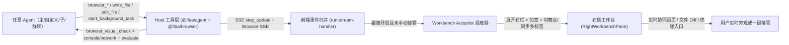

# Agent 自主操控右侧工作台与自测验收闭环方案

状态：**已实施**。本方案将右侧工作台定位为 **所有 LFAA Agent（单聊小鱼、自定义 Agent、子智能体、群聊成员）的自主操作与实测验收台**，打通「Agent 动作 → 自动展开并切换右栏 → 实时同步浏览器多标签/文件 Diff/后台终端 → 截图视觉自检对照需求 → 不符则循环思考修复 → 达标后交付最终答案」的完整闭环。

## 1. 背景与现状断层

1. **前端事件与右栏脱节**：`packages/client/ui-chat/client/store/run-stream-handler.ts` 的 `onStepUpdate` 目前仅刷新 `goal_`，对 `browser_*`、`write_file` / `edit_file`、`start_background_task`、`invoke_subagent` 均未驱动右侧菜单栏展开、切页签或同步宿主机新建的浏览器标签。
2. **后端所有 Agent 缺少右栏验收闭环协议**：`packages/core/agent/src/context/agent-context.ts`（单聊、自定义 Agent、群聊与子智能体共用 `executeAgentTaskLoop`）未明确告知 Agent「右侧工作台与内置浏览器即你的验收现场」，也没有强制「启动/打开页面 → 交互与控制台核验 → 截图/视觉对照需求 → 不达标循环修复 → 验收通过再交差」的执行准则。
3. **视觉自检工具缺少显式需求对照与错误计数回传**：`packages/core/browser/src/tools/browser-tools.ts` 的 `browser_visual_check` 目前仅传 `focus`，未携带本次需逐条核对的 `requirements` 与当前页面 `errorCount` / 失败网络请求摘要，模型较难精准判定「是否已完全符合用户需求」。

## 2. 总体架构与职责划分

### 2.1 后端：统一 Agent 验收闭环协议与工具增强

1. **全局验收闭环提示（`packages/core/agent/src/context/agent-context.ts`）**：
   - 在 `buildProgressHint` 注入「右侧工作台与自测验收闭环」准则（仅当工具集中存在 `browser_navigate` 时激活，覆盖主 Agent、自定义 Agent、子智能体与群聊成员）：
     - 涉及前端界面、页面布局、交互逻辑、Web 服务或网页排查任务，**严禁仅凭改完代码或构建通过就交付**；
     - 必须使用内置浏览器工具在右侧工作台完成闭环验收：**启动服务（`start_background_task`）→ 打开或新建标签（`browser_navigate` / `browser_tabs`）→ 真实点击/输入/滚动交互 → 读取 `browser_console` 与 `browser_network` 确认 0 异常 → 调 `browser_screenshot` 与 `browser_visual_check`（视觉模型不可用时用 `browser_evaluate` 读取几何、样式与 DOM 状态）逐条核对用户原始需求**；
     - 只要自检发现与用户需求不符、存在报错、遮挡、错位或交互失效，**必须继续进入下一轮思考与代码修复，刷新页面复验**，直到全部达标才输出最终答复；
     - 多页对照（如参考页与开发页、不同路由）主动用 `browser_tabs(action="new" | "activate")` 善用多标签页。
2. **增强 `browser_visual_check`（`packages/core/browser/src/tools/browser-tools.ts`）**：
   - 新增可选参数 `requirements`（字符串或验收要点列表），视觉检查提示词按「逐条核对需求 → 明确列出未满足项与可见缺陷 → 给出 PASS / NEEDS_FIX 结论」结构化输出；
   - 自动附带当前页面 `URL`、`console errorCount` 与近期失败网络请求摘要，便于模型直接决策是修复还是收口交付；
   - 若当前模型不支持多模态图片输入，返回明确可操作的降级指引（提示改用 `browser_evaluate` + `browser_snapshot` + `browser_console` 完成闭环核验，不卡死流程）。
3. **浏览器标签与操作方实时同步（`@lfaa/browser`）**：
   - `browser_tabs`（`new` / `activate` / `close`）与 `browser_navigate` 触发后，除返回快照外，立刻通过 `ScreencastManager` 广播一帧/元数据更新（携带 `tabs` 最新列表或由前端收到 `browser_tabs` 步骤完成时立即拉取 `/api/browser/state`），保证 Agent 新建的标签 0 延迟出现在右栏顶部标签栏。

### 2.2 前端：全能跟随调度与用户主权设计

1. **「跟随 Agent」开关（默认开启，持久化到会话/偏好）**：
   - 位置：右侧工作台顶栏操作区（`packages/client/ui-chat/client/workbench/RightWorkbenchActions.tsx` / `WorkbenchTopActions.tsx`），一枚紧凑状态切换按钮（开启时微亮提示「跟随 Agent」，关闭时静默「手动模式」）。
   - 状态归属：写入 `ChatStoreSnapshot.followAgentWorkbench: boolean`（默认 `true`，持久化到 `localStorage`，键名 `lfaa:workbench-follow-agent`）。
   - **防打扰与用户主权**：
     - 用户手动点击右栏「收起面板」按钮时，本轮运行内自动暂停自动弹开（不与用户抢面板），下一轮新发消息或用户重新展开后自动恢复；
     - 用户在浏览器工具栏点击「接管」暂停 Agent 时，保持当前画面不动，交由用户操作。

2. **全能跟随触发矩阵（`packages/client/ui-chat/client/shared/agent-workbench-sync.ts`）**：

| Agent 工具动作 | 触发时机 | 右侧工作台动作 |
|---|---|---|
| `browser_navigate`、`browser_tabs`、`browser_click`、`browser_type`、`browser_scroll`、`browser_hover`、`browser_press_key`、`browser_screenshot`、`browser_visual_check`、`browser_evaluate` | 步骤开始 `running` 或完成 `done` | 若右栏关闭则自动展开并加宽（`setRightPanelOpen(true, false)` + `setRightWorkbenchWide(true)`）；切换右栏主舞台至 `browser`；拉取最新 `/api/browser/state` 刷新顶部多标签条并置为协同画面（自动跟随 `lastActor: "agent"`） |
| `browser_console`、`browser_network` | 步骤完成 `done` | 展开右栏并切到 `browser`；在浏览器面板内可选自动展开 DevTools 日志抽屉并切到对应 Console / Network 页签（通过 `rightPanelRequest` 透传 `devtoolsTab`） |
| `write_file`、`edit_file` | 步骤完成 `done` 且带 `fileChange` | 展开右栏并打开/更新该文件的 `FilePreviewTab`（复用现有 `store.openFilePreview(messageId, stepId)`）；若本轮刚进入浏览器验收阶段（正在操作 `browser_*`），保留浏览器在台前仅后台更新文件标签，不打断浏览器观看 |
| `start_background_task` | 步骤完成 `done` | 展开右栏并点亮最右工具轨的终端运行徽标；若右栏当前在空白欢迎页则自动展开终端辅助栏展示实时服务输出，已在看浏览器/文件时仅更新徽标不抢舞台 |
| `invoke_subagent` | 步骤开始 `running` | 更新最右工具轨的子智能体运行徽标；若当前在空白欢迎页可展示子智能体实时进度 |

3. **Agent 操作中轻量横幅提示**：
   - 当 Agent 正在当前会话驱动浏览器（`runningRunId !== null` 且最近步骤为 `browser_*`）时，浏览器工具栏下方显示极轻一行状态条（例如「小鱼正在操控浏览器进行验收 · 点击可接管」），运行结束自动消失。

4. **全 Agent 覆盖确认**：
   - **单聊小鱼 & 自定义 Agent**：直接走 `ChatRunActions` → `run-stream-handler.ts` → 自动驱动右栏。
   - **子智能体（`invoke_subagent`）**：子智能体通过 `onSubagentActivity` 汇报子步骤，且共享同一 `sessionId` 的浏览器实例；前端监听子步骤中的 `browser_*` / 文件活动同样能触发右栏同步。
   - **群聊 Agent（`@lfaa/agent-group`）**：群聊成员调用 `browser_*` / 文件工具同样走 `executeAgentTaskLoop` 与同一会话的 `BrowserService`，后端验收闭环协议天然全覆盖。

## 3. 预计改动范围

- **后端（`@lfaa/agent`、`@lfaa/browser`）**：
  - `packages/core/agent/src/context/agent-context.ts`：注入右侧工作台自测验收闭环准则；
  - `packages/core/browser/src/tools/browser-tools.ts`：`browser_visual_check` 支持 `requirements` 参数、附带控制台/网络错误计数及无视觉能力降级指引；
  - `packages/core/browser/src/session/browser-service.ts`：`createTab` / `activateTab` / `closeTab` 标记 `lastActor = fromAgent ? "agent" : "user"`。
- **前端（`@lfaa/client-ui-chat`、`@lfaa/client-ui-browser`）**：
  - 新增 `packages/client/ui-chat/client/shared/agent-workbench-sync.ts`：纯映射函数，把 `AgentStepTrace` 映射为右栏跟随意图（含单测）；
  - `packages/client/ui-chat/client/store/{chat-preferences.ts,chat-types.ts,chat-store-port.ts,chat-store.ts,chat-file-actions.ts,run-stream-handler.ts}`：新增 `followAgentWorkbench` 状态、本轮手动收起暂停标记、步骤触发右栏意图派发；
  - `packages/client/ui-chat/client/index.tsx`：监听右栏自动展开请求并调用 `context.workbench.setRightPanelOpen(true, false)` 与 `setRightWorkbenchWide(true)`；
  - `packages/client/ui-chat/client/workbench/{RightWorkbenchPane.tsx,RightWorkbenchActions.tsx,WorkbenchTopActions.tsx,WorkbenchStageContent.tsx,useWorkbenchBrowser.ts,useWorkbenchRequests.ts}`：增加「跟随 Agent」顶栏开关、响应浏览器同步请求（主动刷新宿主机多标签并支持自动展开 DevTools 抽屉）；
  - `packages/client/ui-browser/client/panes/{RightBrowserPane.tsx,browser-render-mode.ts,useBrowserSessionSync.ts}`：支持 `agentRunning` 空闲自动回归 60/120fps 原生直连（且原生直连下关闭后台 SSE 推流）与 `devtoolsRequest` 联动。
- **测试与验证**：
  - 单元测试：`agent-workbench-sync.test.ts`（覆盖全能跟随矩阵、浏览器优先防打断、手动收起本轮静默、关闭开关不触发）、`browser-service.test.ts`（覆盖 `browser_visual_check` 的 `requirements` 与 `browser_tabs` 的 `lastActor`）、`agent-loop.context.test.ts`（校验系统提示包含闭环验收规则）；
  - 门禁与实测：`pnpm check`、`pnpm lint`、`pnpm typecheck`、`pnpm test`、`pnpm build`、`pnpm verify:web`，重启 `127.0.0.1:5173` 并通过内置浏览器端到端实测「收起右栏 → Agent 调用浏览器工具自动展开并新建标签/切协同视图 → 改文件自动开 Diff 标签 → 关闭跟随开关后不自动抢焦点」。

## 4. 待负责人评审确认点

1. **防打断优先级**：当 Agent 正在用浏览器验收时又顺手改了一个小文件，方案默认「改文件只静默打开/刷新文件标签，不把台前的浏览器顶掉」，等浏览器操作结束后可随时点文件标签看 Diff——这个优先级是否符合你的直觉，还是希望每改一个文件都切过去看一眼？
2. **「跟随 Agent」开关位置**：放在右侧工作台顶栏右上角操作组里（与最大化、收起右栏相邻），是否顺手？
3. 确认无异议后即可按上述范围直接实施、跑全套门禁并重启本地服务交付。
