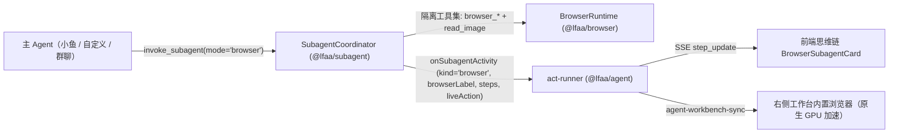

# 浏览器专属子智能体与性能根治方案

状态：**已实施**。本方案结合负责人的两点要求落地：（1）在主 Agent 思维链中以专属「浏览器子智能体（Browser Subagent）」隔离执行网页打开、交互测试、控制台检查与视觉验收，并呈现清晰的实时浏览器状态条与可展开步骤卡片；（2）根治内置浏览器原生直连时后台无头页面重复渲染 60fps 动画及兜底画布主线程解码卡顿问题。

## 1. 背景与目标

1. **思维链可视化与上下文隔离**：
   - 主 Agent 直接在主循环里连续执行十几步 `browser_navigate` / `browser_click` / `browser_snapshot` / `browser_console` 时，DOM 文本会迅速膨胀主上下文窗口，且对话流中缺少「Agent 正在使用哪个浏览器、正在做哪一步」的聚焦提示。
   - 引入 `mode: "browser"` 的专属浏览器子智能体后，多步网页验收在隔离子上下文内完成并回传结构化结论；对话思维链展示紧凑实时状态行（如「正在使用内置浏览器 · 思考中 (16s)...」）以及可展开的「子智能体 · N 浏览器步骤」清单，同时主 Agent 仍保留直接调用 `browser_*` 工具作为单步快捷兜底。
2. **浏览器性能二次根治**：
   - **原生直连下后台零空跑**：当页面在前端原生 `<iframe>` 渲染（享受宿主浏览器 GPU 硬件加速）且无 SSE 推流订阅、无 Agent 工具调用超过 2.5 秒时，后台 Playwright 无头页面自动通过 CDP 暂停动画与节流 CPU；下次 Agent 调用任意浏览器工具或开启推流前瞬间恢复，避免前后端双开 60fps 动画消耗资源。
   - **兜底画布解码零主线程循环**：消除 `BrowserCanvasViewport` / `decodeBase64ToBlob` 中的同步 JS `for` 循环逐字节 `charCodeAt` 拷贝，改用原生 `Uint8Array.fromBase64`（可用时）或 `HTMLImageElement.decode()` 后台线程解码，确保被 `X-Frame-Options` 拦截而走 CDP 兜底的网页也不卡主线程。

## 2. 架构与契约设计

### 2.1 后端契约与调度

1. **步骤契约（`@lfaa/session` → `@lfaa/memory`）**：
   - `AgentStepTrace["subagent"]` 新增可选字段：`kind?: "general" | "browser"`、`browserLabel?: string`、`liveAction?: string`、`steps?: SubagentStepPreview[]`。
2. **工具活动回传契约（`@lfaa/tools`）**：
   - `SubagentActivityUpdate` 新增可选 `kind`、`browserLabel`、`liveAction`，`activity` 补充 `label?: string` 与 `target?: string`。
3. **专属浏览器子智能体（`@lfaa/subagent`）**：
   - `invoke_subagent` 的 `mode` 枚举扩展为 `"read" | "write" | "browser"`；
   - `mode === "browser"` 时：工具视图只放行 `browser_*` 与 `read_image`；系统任务前缀注入专属浏览器验收守则（打开页面 → 真实交互 → `browser_console` / `browser_network` 查错 → `browser_visual_check` 或 `browser_evaluate` 核验需求 → 遵守人工接管暂停 → 返回结构化验收报告）；
   - `SubagentCoordinator` 实时上报思考阶段（`liveAction: "思考中"`）与每个工具步骤的中文动作与目标参数，并依据 `@lfaa/browser` 当前设置标注 `browserLabel`（无头模式为「内置浏览器」，有头模式为「桌面浏览器」）。
4. **主 Agent 引导策略（`@lfaa/agent`）**：
   - `buildProgressHint` 在同时存在 `invoke_subagent` 与 `browser_navigate` 时，强烈建议主 Agent 对多步网页浏览、交互自测与视觉验收派发 `invoke_subagent(role="浏览器验收助手", mode="browser", ...)`，同时保留主 Agent 直接调用 `browser_*` 进行单步核查的兜底能力。
5. **后台无头浏览器空闲省电（`@lfaa/browser`）**：
   - `BrowserRuntime` 维护每会话空闲暂停计时器：当页面可嵌入、无活跃推流订阅且超过 2.5 秒无工具调用时，通过 CDP `Animation.setPlaybackRate({ playbackRate: 0 })` 与 `Emulation.setCPUThrottlingRate({ rate: 6 })` 暂停后台重复动画渲染；每次 `ensureSession` / 任意工具操作 / 订阅推流前立即恢复（`playbackRate: 1, rate: 1`）。

### 2.2 前端思维链卡片与性能渲染

1. **`Browser-Subagent-Card.tsx`（`@lfaa/client-ui-chat`）**：
   - 运行中呈现紧凑脉冲提示条：`正在使用内置浏览器 · 思考中 (16s)...` 或 `正在使用内置浏览器 · 正在打开 http://...`；
   - 点击展开「子智能体」步骤面板：顶部展示角色名、浏览器类型徽标与「`N 浏览器步骤`」计数，正文以左侧细竖线列出每一步动作、目标与状态，底部支持查看验收摘要并一键切到右侧工作台内置浏览器；
   - 严格消费 `@lfaa/ui-theme` 语义 CSS 变量，双主题下对比度达标。
2. **右栏全能跟随同步（`agent-workbench-sync.ts`）**：
   - 当 `step.subagent?.kind === "browser"` 时直接触发右栏自动展开并同步内置浏览器标签与快照，无需依赖正则猜测。
3. **兜底画布零主线程拷贝解码（`@lfaa/client-ui-browser`）**：
   - `BrowserCanvasViewport` 优先用 `Uint8Array.fromBase64` + `createImageBitmap` 或原生 `HTMLImageElement.decode()` 后台解码，移除主线程几十万次循环 `charCodeAt` 拷贝。

## 3. 验收标准

- 单元测试：`subagent.test.ts` 验证 `mode: "browser"` 仅放行 `browser_*` 工具且实时回传 `kind: "browser"` 与步骤明细；`browser-service.test.ts` 验证后台空闲省电暂停与工具唤醒恢复正常；`agent-workbench-sync.test.ts` 与 `agent-loop.context.test.ts` 覆盖浏览器子智能体联动与提示策略。
- 全量门禁：`pnpm map:sync`、`pnpm check`、`pnpm lint`、`pnpm typecheck`、`pnpm build`、`pnpm probe:boot`、`pnpm probe:loader`、`pnpm verify:web` 全部通过。
- 内置浏览器现场验收：验证思维链浏览器子智能体卡片在深/浅双主题渲染与折叠展开正常、原生直连 60fps 流畅、控制台 0 报错。
