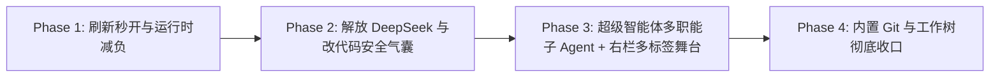

# LFAA 超级智能体体验、性能与 Git/工作树一体化升级方案

- 状态：**已实施**（2026-11-25，`DEV-000509`）
- 日期：2026-11-25
- 覆盖范围：四大专项（刷新性能秒开、DeepSeek/小鱼智能体提速与改代码安全气囊、超级智能体多职能子 Agent 编排与右栏多标签舞台、内置 Git 与工作树彻底收口）

---

## 1. 背景与核心痛点

基于全仓实测与源码排查，当前影响日常使用和自举开发体验的四大核心问题如下：

1. **刷新（F5）卡顿**：开发服未对非 `/api` 静态模块短路导致每个 `.ts/.tsx/.css` 请求空跑 30 个后端路由（约 15,000 次无效派发）；12 个前端插件全部同步首屏导入；`SessionMemoryStore.list()` 零缓存且首屏并发全盘解析两次（4.56 MB JSON 阻塞单线程事件循环）；首屏同时炸出 19–21 个 HTTP 请求（含未使用的 `/api/storage`、重复 2–3 次的 `/api/plugins`、空闲仍每 2.5s 轮询的 `/api/jobs` + `/api/subagents`）；壳层内联回调击穿长会话 `React.memo`。
2. **小鱼 Agent 干活慢、发挥不出 DeepSeek 实力、改代码缺少保护**：
   - 默认锁死 `reasoningEffort = "high"`；`openai-adapter.ts` 在火山方舟与 DeepSeek Reasoner 直连场景下错误丢弃多轮 `reasoning_content`；`capabilities.ts` 漏匹配 `deepseek-v4*`/`deepseek-v3*`。
   - 首轮上下文膨胀至 15k–23k tokens（37–54 个工具 + 40 个无关内置技能目录 + 冲突指令），且 `historyDigest` 拼进 `systemMessage[0]` 导致每轮 KV Prompt Cache 失效。
   - `edit_file` 不做 CRLF/LF 归一化导致 Windows 文件反复编辑失败；`spill-local` 落盘到工作区外导致 `read_file` 必报越界；缺少改前轻量快照、单轮一键撤销与 `full` 模式下极端破坏性命令硬拦截。
3. **缺少「超级智能体」多职能子 Agent 编排与可视化舞台**：小鱼面对复杂排查/实现/审查任务时习惯单兵硬扛、把主上下文迅速塞爆；虽然后端已有 `@lfaa/subagent`，但缺少专门的职能预设（调研/编码/浏览器/审查）、缺少主对话区轻量状态行与回执折叠卡，也缺少在右侧工作台**以新建独立标签方式**并行打开并实时围观/直接追问多个子 Agent 的交互体验。
4. **内置 Git 与工作树（Worktree）重复、冲突、半成品**：3 套行为打架的 `git` 执行器、3 套冲突的分支前缀、3 套各缺一半的变更 UI、4 处工作树断链（子目录 `inspect` 忽略 `?path=`、代码审查与 `/review` 漏传 `sessionId`、右栏打开文件漏传 `worktreeId`、工作树切分支后记录永久失步），以及大量后端未实现的「假开关」设置；Agent 也没有只读 Git 工具与仓库上下文。

---

## 2. 总体架构与四阶段实施路线

每个阶段独立可验证、可回滚，均严格执行 `pnpm map:sync` → `pnpm check` → `pnpm lint` → `pnpm typecheck` → `pnpm test` → `pnpm build` → `pnpm probe:boot` → `pnpm probe:loader` → `pnpm verify:web` + 内置浏览器实测验收。

---

## 3. Phase 1：首屏刷新秒开与运行时减负

### 3.1 目标指标
- 开发态 F5 刷新：非 `/api` 模块零后端路由空转；首屏 `/api/*` 请求数从 19–21 条压降至 ≤ 8 条；
- 会话列表读盘：无文件变动时 `GET /api/chat/sessions` 与 `/api/agent/attention` 命中内存摘要缓存，0 次 `JSON.parse`；
- 长会话刷新与流式帧：`ChatMessageRow` `React.memo` 命中率恢复，空闲态零无谓 2.5s 后台轮询。

### 3.2 改动清单

| 模块 | 文件 | 具体改动 |
|---|---|---|
| 开发服短路 | `packages/host/web-server/src/dev-server.ts` | 中间件入口先判断 `if (!isApiPath(req.url)) return next();`，跳过全部 30 个 API 处理器与鉴权逻辑 |
| 会话摘要缓存 | `packages/core/session/src/session-store.ts` | 维护 `Map<string, { mtimeMs: number; size: number; summary: ChatSessionSummary; pendingQuestion?: ... }>`；`list()` 仅 `stat` 目录文件，未变更直接命中缓存；`writeSession`/`deleteSession` 同步更新缓存 |
| 消除重复扫盘 | `packages/core/agent/src/index.ts` | `listAttention()` 复用带缓存的 `listSessions()` 摘要，不再二次全盘解析 |
| 首屏请求瘦身 | `packages/client/ui-chat/client/store/chat-store-bootstrap.ts` | 首屏不再预拉 `/api/storage`、`/api/library`、`/api/rules`（改为进入资料库/存储/规则设置页时按需加载）；合并重复请求 |
| 去重插件请求 | `packages/client/ui-chat/client/composer/Session-Mode.tsx`、`packages/client/ui-plugins/client/index.tsx` | 共享模块级 `/api/plugins` 预设缓存，避免首屏重复请求 2–3 次 |
| 停止空闲轮询 | `packages/client/ui-chat/client/workbench/useWorkbenchSummary.ts` | 仅在当前会话有运行中任务/子智能体、或用户打开终端/子智能体面板时开启轮询；空闲且关闭时停掉 2.5s `setInterval` |
| 路由级懒加载 | `apps/web/src/main.tsx` 及非首屏 UI 插件入口 | 对 `Agents`、`群聊`、`资料库`、`代码审查`、`技能`、`插件`、`MCP`、`设置中心` 等非首屏视图使用 `React.lazy` 动态分包 |
| 稳住 `React.memo` | `packages/client/ui-chat/client/index.tsx` | 稳定 `ChatWorkspace` 的 `onOpenFilePreview` / `onOpenTurnChanges` / `onOpenBrowser` / `onOpenSettings` 等回调引用，避免壳层更新击穿历史消息行缓存 |

---

## 4. Phase 2：解放 DeepSeek 实力 + 改代码「安全气囊」

### 4.1 解放 DeepSeek 速度与准确率

| 问题 | 文件 | 具体改动 |
|---|---|---|
| 默认推理档位过高 | `packages/client/ui-chat/client/store/chat-preferences.ts`、`packages/core/llm/src/ark-plan.ts` | 默认 `reasoningEffort` 从 `"high"` 调整为 `"medium"`（保持界面可随时一键切 `"low"` / `"high"` / `"max"`） |
| DeepSeek 多轮 `reasoning_content` 协议断裂 | `packages/core/llm/src/adapters/openai-adapter.ts`、`packages/core/llm/src/capabilities.ts` | 补齐 `deepseek-v4*` / `deepseek-v3*` 能力匹配；修正 `enableThinking` 判定，保证火山方舟（Ark）、DeepSeek 直连及 `deepseek-reasoner` 在多轮工具调用中始终回传 `reasoning_content`；`anthropic-adapter.ts` 默认 `maxTokens` 提升至 `8192` |
| 恢复跨轮 KV Cache | `packages/core/agent/src/run/run-system.ts`、`packages/core/agent/src/run/run-context.ts` | 将动态变化的 `historyDigest` 移出静态 `systemMessage[0]`（改为注入历史上下文消息或尾注），保持系统提示前缀跨轮字节级不变 |
| 首轮上下文与工具瘦身 | `packages/core/agent/src/context/agent-context.ts`、`packages/core/rules/src/index.ts`、`packages/core/tools/src/builtin-tools.ts` | 1）默认系统提示不再硬塞全部 40 个内置技能长摘要，仅保留已启用个人/项目技能 + 一句「按需调用 `list_skills`/`load_skill`」提示（砍掉 ~6,500 字符噪音）；2）统一搜索工具推荐为 `grep`/`glob`，消除与 `search_files` 及并行写文件的矛盾指令；3）`AGENTS.md` 截断上限提升并按章节边界截断，不拦腰截断 §6–§8 |
| `edit_file` 与 `read_file` 容错 | `packages/core/tools/src/edit-tools.ts`、`packages/core/tools/src/builtin-tools.ts` | `edit_file` 自动处理 CRLF/LF 换行归一（写回保持原文件换行风格），匹配失败时返回最相近上下文行号帮助一次修正；`read_file` 默认行数提升至 300 行 |
| `spill-local` 沙箱闭环 | `packages/spill/spill-local/src/index.ts`、`packages/core/fs/src/sandbox.ts` | 允许 `read_file` 只读访问当前会话对应的 `~/.lfaa/spills/<sessionId>/` 目录，打通超长输出落盘回读链路 |
| 精简无效返工 | `packages/core/agent/src/run/verification.ts`、`packages/core/agent/src/run/todo-plan.ts` | `isVerificationCommand` 识别 `node`/`python`/`vitest`/`pytest`/`go test`/`cargo test` 等常见验证命令；纯静态样式/单文件小改不强推 `todo_write` 与多余自检轮次 |

### 4.2 改代码「安全气囊」（含自举改 LFAA 自身保护）

1. **单轮轻量文件快照 + 一键撤销（Per-Turn Undo）**：
   - 新增 `packages/core/agent/src/run/turn-snapshot.ts`：在单轮运行首次修改某个文件前，仅对**被本轮改动到的文件**保存修改前原文（或标记 `created: true`）到会话级快照存储（`~/.lfaa/snapshots/<sessionId>/<assistantMessageId>.json`），**绝不触碰用户其他未提交文件**。
   - 新增接口 `POST /api/agent/sessions/:sessionId/messages/:messageId/undo`：一键把该轮 Agent 修改/新建的文件精确还原回本轮开始前状态（若文件之后又被用户手工改过，先比对哈希提示冲突，绝不盲覆盖）。
   - 在对话消息的「已编辑文件」卡片与右栏 `Turn-Changes` 增加**「撤销本轮改动」**按钮。
2. **高危硬闸与敏感路径分级**：
   - `packages/core/agent/src/tools/permission-policy.ts`：
     - 即使在 `full`（完全访问）模式下，对极端破坏性命令（`rm -rf`、跨目录删除、`git reset --hard`、`git clean -fd`、`git push --force`）仍强制弹出二次确认（仅显式勾选「本轮放行高危」才跳过）。
     - 在 `smart`（智能信任）模式下，将写入/编辑信任键按路径敏感度分层：普通代码文件与高敏感路径（`.git/`、`.env*`、`pnpm-lock.yaml`、`package.json`、`scripts/`）分离，避免批过 3 次普通文件后连锁文件与核心配置一起静默放行。
   - 审批弹窗直接展示精简 Unified Diff 预览（复用现有 diff 生成器），而不再只展示截断的 JSON 参数串。

---

## 5. Phase 3：超级智能体多职能子 Agent 编排 + 右侧多标签实时舞台

### 5.1 交互体验设计（对齐超级智能体工作流）

1. **职能化子 Agent 角色体系（`@lfaa/subagent` 升级）**：
   - 扩展 `SubagentMode` 与内置职能模板：
     - `research`（只读调研/全仓排查）：拥有 `list_dir` / `read_file` / `grep` / `glob` / 只读 `git_status` / `git_diff` / `web_fetch`，**并行不阻塞主线程**，独立上下文不污染主对话；
     - `coder`（独立编码实现）：拥有读写与命令工具，支持绑定独立工作树或共享工作区（写操作遵循工作区锁或自动提示隔离）；
     - `browser`（内置浏览器实操与视觉验收）：复用现有浏览器子智能体；
     - `reviewer`（只读代码与安全审查）：专精 diff 审查、回归风险与规范检查。
   - 升级主 Agent 系统提示与编排规则：遇到「全仓排查 / 多模块并行分析 / 复杂改动 + 独立验收」时，主动拆分为 2–4 个互补职能的子 Agent **同一轮并行派发**（`wait: false` 后台并行启动，随后统一汇总），简单单文件问答则直接干，不画蛇添足。
   - 新增 `wait_subagents` 工具（或增强 `invoke_subagent` 批量并行等待）：主 Agent 并行派发多个子 Agent 后可一次等待全部完成并一次性拿到各子 Agent 的结构化报告，减少轮次空转。

2. **中间主对话区：轻量状态行 + 底部汇总 + 完成后回执折叠卡**：
   - 每次派发子 Agent，在主对话思维链中渲染紧凑的 `Subagent-Dispatch-Row`：
     - 运行中：`Started :: <Role>`（柔和脉冲点 + 职能图标 + 已耗时，点击立刻在右栏激活该子 Agent 标签）；
     - 完成后：`Started ✓ <Role>`（绿色完成图标 + 总步骤数/耗时，点击切到右栏查看完整过程）。
   - 当有多个子 Agent 在运行，在消息底部显示轻盈的状态条：`3 个子智能体运行中 · 点击查看`。
   - 子 Agent 完成回传结果时，在主对话区渲染可折叠的回执条：`来自 <Role> (<mode>) 的汇报 >`（默认收起保持主线清爽，展开可看完整返回摘要）。

3. **右侧工作台：新建独立子 Agent 标签 + 直接复用现有流式工作链（`AssistantTimeline`）+ 回传主智能体提示**：
   - 扩展 `WorkbenchTabs.tsx` 的 `RightStageKind` 新增 `"subagent"`，并新增 `subagentTabs: SubagentTabItem[]`：
     - 主 Agent 每派发一个子 Agent（遵守「跟随 Agent」开关且未在本轮手动收起），右侧工作台自动**新建一个专属标签**（如 `:: 性能瓶颈排查`、`:: Git 架构审计`），带运行中转圈 / 完成后勾图标，支持随时点标签切换、关闭标签（仅关视图不杀后台任务）。
   - **彻底复用现有流式输出与工作链组件（零重复造轮子）**：
     - 后端 `GET /api/subagents/:id/stream` 直接复用与主对话同构的流式事件协议（`snapshot` / `delta(reasoning|text)` / `step_update` / `run_usage` / `run_finished`），前端复用同一套流式增量归并与节流渲染；
     - 子 Agent 标签页（`Subagent-Stage-View.tsx`）主体直接挂载我们已打磨好的 **`AssistantTimeline`** 组件，因此子 Agent 天然拥有和主对话一模一样的逐字流式思考块、文件/命令活动行对齐、代码块高亮与展开/折叠体验，**不再单独写一套简化版步骤列表**。
   - **子 Agent 标签页内的双向交接提示**：
     - **顶部**：角色名 + 职能徽标（`research` / `coder` / `browser` / `reviewer`）+ 「停止」按钮（运行中）+ 右上角「正在工作 / 已完成」快速切换器；
     - **任务接收区**：可折叠的 `来自主智能体的任务指令 >`（点击展开查看派发原文）；
     - **工作链主体（复用 `AssistantTimeline`）**：运行中实时流式输出思考过程、已分析文件与行号、已运行命令；结束后自动折叠成紧凑的 **`总耗时 Xm Xs >`**（点开随时回看完整工作链）；
     - **回传主智能体回执提示**：完成后在 `总耗时` 下方清晰展示一句回执状态——**「排查/任务已完成，结果已回传给主智能体。」**（支持展开查看完整回传报告）；
     - **底部输入框**：`向 <Role> 发送补充指令或追问…`（直接调用 `POST /api/subagents/:id/message`，追问后同样在标签内以新一轮流式工作链继续执行并同步结果）。

### 5.2 涉及文件与边界
- 后端（`packages/core/subagent/`）：
  - `src/types.ts`：扩展 `SubagentKind = "research" | "coder" | "browser" | "reviewer" | "general"`、`SubagentEvent`（step/delta/status/finished）
  - `src/subagent-presets.ts`（新增）：按职能定义工具白名单、默认步数与精简角色系统提示
  - `src/subagent-service.ts`：支持事件订阅 `subscribe(id)`、`waitMany(ids)`、多子智能体并发调度与独立清理
  - `src/http-handler.ts`：新增 `GET /api/subagents/:id/stream`（SSE）与 `POST /api/subagents/:id/message`
- 前端（`packages/client/ui-chat/client/`）：
  - `workbench/WorkbenchTabs.tsx`、`workbench/WorkbenchStageContent.tsx`、`workbench/RightWorkbenchPane.tsx`：接入多子 Agent 标签管理与自动新开标签
  - `workbench/Subagent-Stage-View.tsx` + `.module.css`（新增）：子 Agent 标签主舞台——直接复用 `AssistantTimeline` 与同构流式事件流（父指令折叠、逐字流式思考/正文、工具活动行、完成后折叠为 `总耗时 Xm >` +「结果已回传给主智能体」提示、底部追问框）
  - `conversation/Subagent-Dispatch-Row.tsx` + `.module.css`（新增）：主对话区 `Started :: <Role>`、运行中汇总条与完成后回执折叠卡（与现有 `Browser-Subagent-Card.tsx` 统一设计语言）

---

## 6. Phase 4：内置 Git 与工作树（Worktree）彻底收口

### 6.1 后端收口与断链修复

| 项 | 文件 | 具体改动 |
|---|---|---|
| 统一 Git 执行底座 | 新建 `packages/util/git-exec/`（或下沉到 `@lfaa/review` 导出供 `worktree` 与 `agent` 复用，按 `dependency-rules.json` 最简合法方向放置） | 合并 `git-run.ts`、`git-command.ts`、`project-git.ts` 为单一安全执行器：统一 `-c core.quotepath=false` + `hardenedGitArgs`（禁 hooks/fsmonitor/filters）+ 清理 `GIT_DIR`/`GIT_WORK_TREE` 等环境变量 |
| 修复 4 处工作树断链 | `packages/workspace/worktree/src/{http-handler.ts,worktree-service.ts}`、`packages/client/ui-chat/client/settings/coding-settings-client.ts`、`packages/client/ui-chat/client/workbench/{RightGitReviewPane.tsx,WorkbenchStageContent.tsx}`、`packages/client/ui-review/client/views/CodeReviewView.tsx` | 1）`/api/worktrees/:id/inspect` 正确支持 `?path=` 子目录（含 `realpath` 越界校验）；2）`postRunCodeReview` 与 `/review` 透传 `sessionId`；3）`RightGitReviewPane` 点「打开文件」传入 `worktreeId`，且 `key` 改为 `${boundProjectId}:${sessionId}:${boundWorktreeId ?? ""}`；4）工作树内切分支后同步刷新 `WorktreeRecord.branch` 与 `session.worktree.branch` |
| 统一分支前缀与真合并 | `packages/workspace/worktree/src/worktree-service.ts`、`packages/client/ui-workspace/client/worktree/{WorktreeDialog.tsx,WorktreeSection.tsx}`、`packages/client/ui-chat/client/store/chat-session-actions.ts` | 全部统一读取 `coding-settings.git.branchPrefix`；`WorktreeSection` 去掉写死 `force=true`（先安全删除，脏目录提示用户确认再强制）；新增 `POST /api/worktrees/:id/merge`（检查主工作区干净 + `previewMerge` 无冲突后执行真实 `--no-ff` 合并并可选清理工作树） |
| 让 Agent 看得见 Git | `packages/core/tools/src/`（或 `@lfaa/review` 注册工具）、`packages/core/agent/src/context/agent-context.ts` | 注册 2 个只读工具 `git_status` / `git_diff`（无需 `exec` 审批）；在 `buildWorkspaceHint` 为 Git 项目注入 2 行精简上下文（当前分支、脏文件数、是否位于工作树）；`autoGit` 初始化改为设置项可控（默认关闭或仅对空目录生效） |

### 6.2 前端减法：砍掉假开关，理清两套视图职责

- **清理假设置**：在 `packages/client/ui-review/client/settings/{CodeReviewSettingsView.tsx,GitSettingsView.tsx}` 中移除全部后端未实现的占位开关（重复的 `thoroughReview`、`autoReview`、`triggerCondition`、`repoOverrides`、`useQuotaForReview`、`repoProvider(github)`、`prMergeMethod`、`alwaysForcePush`、`createDraftPr`、`prInstructions`），只保留真实生效的设置（如默认分支前缀、提交信息风格、自动初始化 Git 开关、审查规则），严格遵守 `docs/standards/settings-ui.md`「未接入不占位」。
- **理清归属与视图分工**：
  - 将 `coding-settings-client.ts` 迁回 `packages/client/ui-review/client/`（按需由 `ui-chat` 通过合法契约消费），消除反向归属；
  - **右栏 Git 面板（`RightGitReviewPane`）**：专注当前会话（自动跟随项目或工作树）的**轻量高频闭环**——查看变更文件与 `+N -M`、展开 Diff、一键「打开源码」、一键「暂存 / 取消暂存」、一键「放弃更改（接入 `/api/git/revert-files`）」、快速填写/生成提交并提交；
  - **单轮改动（`Turn-Changes`）**：专注单轮 Agent 改动对比 + **一键撤销本轮改动**；
  - **全页代码审查（`CodeReviewView`）**：专注仓库级重操作——分支管理、提交历史、工作树列表与一键合并、以及真正接入 LLM（替代 5 条写死正则，保留正则做快速预检）的 AI 代码审查报告。

---

## 7. 验收标准与风险控制

1. **门禁标准**：每个阶段交付均须全绿通过 `pnpm map:sync`、`pnpm check`、`pnpm lint`、`pnpm readme:pair`、`pnpm typecheck`、`pnpm test`、`pnpm build`、`pnpm probe:boot`、`pnpm probe:loader`、`pnpm verify:web`。
2. **双主题与实测标准**：每个涉及 UI 的阶段均须重启本地 `http://127.0.0.1:5173/` 并在内置浏览器实测浅色/深色双主题、零控制台报错、核心交互闭环：
   - Phase 1：实测 F5 首屏网络面板 `/api/*` 请求数 ≤ 8、无重复 `/api/plugins`、无 `/api/storage` 抢跑、无控制台报错；
   - Phase 2：实测 DeepSeek 多轮工具调用保留 `reasoning_content`、Windows CRLF 文件一次编辑成功、单轮改动可一键撤销且不伤用户原有改动；
   - Phase 3：实测向小鱼下达复杂排查任务，主对话出现并行 `Started :: <Role>` 状态行、右侧工作台自动以多标签打开各子 Agent 实时过程并支持底部直接追问、完成后结果回传主对话汇总；
   - Phase 4：实测工作树子目录浏览、工作树内审查与打开文件、切分支同步、工作树一键合并回主分支与放弃单文件改动全部畅通。
3. **回滚控制**：四个阶段按独立模块推进，不改动用户已有会话与项目磁盘格式，每阶段均具备向后兼容与单模块回滚能力。
