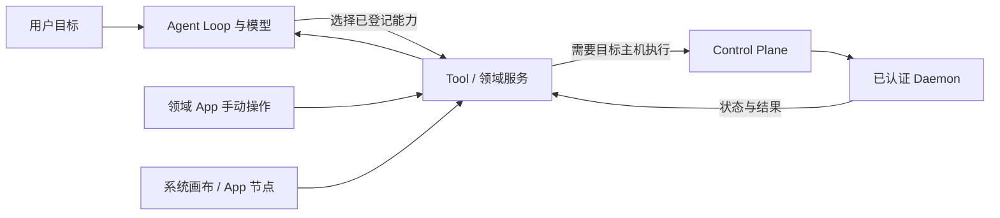

# LFAA 系统总体架构

本文说明当前系统的主要入口、组件职责和执行边界。详细包 Owner 见[包职责规范](development/package-responsibilities.zh.md)，实际装配见[运行入口图](workspace-entry-map.md)，各包状态见[包清单](harness-packages.md)。历史实现和验收记录请从 [PROMPTS 索引](PROMPTS.md) 查找。

## 一页概览

LFAA-Harness 是自有运行时、能力包和应用服务的 Agent 工作台。用户在 `/work` 描述通用目标；模型根据当前配置和可用能力决定下一步。系统画布从 `/canvas` 进入，选择 App 后使用该 App 已登记的节点能力。领域 App 同时提供手动操作界面。

聊天、画布和手动界面共用同一领域服务、数据 Owner 与 Permission Owner。需要操作目标主机时，控制端将经过授权的任务交给已认证 Daemon；Daemon 返回真实状态和结果，Agent 再决定是否继续。

## 组件职责

| 部分 | 负责什么 | 不负责什么 |
|---|---|---|
| `apps/*` | 启动、平台封装、Profile 选择与进程收尾 | 领域规则、内容正文和数据权威 |
| `packages/boot`、`packages/bundle` | 加载能力、组合 Profile/Bundle、管理生命周期 | 重复实现或复制领域能力 |
| `packages/client` | 界面、交互、展示状态及调用 API | 服务端凭据、数据库、节点执行和授权决策 |
| API / Control Plane | 认证上下文、协议适配、输入校验和调用领域服务 | 代替领域 Owner 决定业务规则 |
| 领域能力包 | 领域规则、数据及公开服务合同 | 其他领域的数据和规则 |
| Daemon | 在已验证目标节点执行真实任务并回报 | 替模型决定目标或业务流程 |
| Agent Loop | 组织模型回合、上下文、Tool 往返、等待、停止和执行证据 | 固定业务流程或绕开 Tool Owner |

包依赖、公开入口、消费者及逐包状态以[包职责规范](development/package-responsibilities.zh.md)、包 README 和生成清单为准。目录存在或 `implemented` 标记不代表已装配、可运行或已实测。

## AI、权限与数据

模型依据用户目标选择已接入的 Tools、Skills、专家和子 Agent，并根据真实执行结果继续判断。未登记、未装配或没有执行器的能力不可宣称可用；不以关键词流程、静默降级或假成功代替模型决策。

账户身份、凭据、设置、Session、领域数据和节点执行分别由唯一 Owner 管理。所有 App、Tool、Skill、MCP、子 Agent 与节点操作共用设置中心及 Permission Owner 的三种权限模式：请求审批、替我审批、完全访问。权限模式不取代认证、目标/参数校验、数据隔离或执行结果核验。

前端负责呈现和交互；服务端校验身份、权限和参数；需要节点执行的操作由 Daemon 在目标主机完成。派发或排队不等于成功，未知结果不能伪报完成或自动重放。

存储介质、迁移、事务和恢复见[存储说明](subsystems/storage.zh.md)；认证、权限与执行链见[执行控制说明](subsystems/execution-control.zh.md)。

## 应用与运行入口

- `/work`：通用聊天、项目与代码工作。
- `/canvas`：系统级画布；节点由当前 App 登记。AI 漫剧已有专属节点；Minecraft 和 SteamCMD 节点接入仍待完成。
- 领域 App：管理各自的数据和手动操作，并通过共享服务接入 Agent。
- Web：由 Web Client、Control Plane 和按配置托管的本机/远程 Daemon 提供服务。
- 桌面：当前主线为 Windows x64 Electron。macOS、Linux 和 Android 桌面/客户端尚未交付；Tauri 是保留的兼容路径。

运行时应用注册和内部应用市场尚未实现。游戏联机服务仍缺完整邀请、语音、协作及跨网验收。能力状态以[当前开发计划](开发计划.md)和代码为准。

## 构建与文档权威

构建产物统一写入仓库根目录 `dist/`。Web、Control Plane、Daemon 与桌面包的目录和命令见根目录 [README](../README.md) 及 [CLI 指南](user/cli.zh.md)。

| 信息 | 唯一入口 |
|---|---|
| 当前结构和职责边界 | 本文、包 README 与包职责规范 |
| 当前实现、缺口和优先级 | [开发计划](开发计划.md) |
| 单次任务目标、决定和验收证据 | [任务合同索引](PROMPTS.md) |
| 正式产品版本及发行记录 | [更新日志](updata-log.md) |
| 用户/运维启动与配置 | [CLI 指南](user/cli.zh.md) |

历史合同和归档文件只证明当时的实现、环境与验收结果，不覆盖当前源码和本架构，也不构成操作授权。
